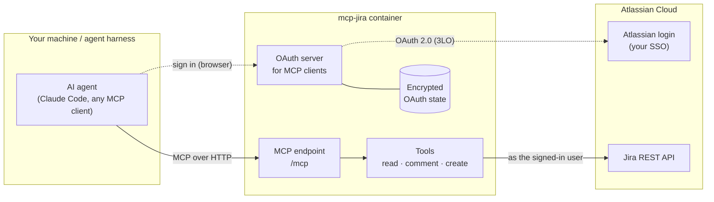
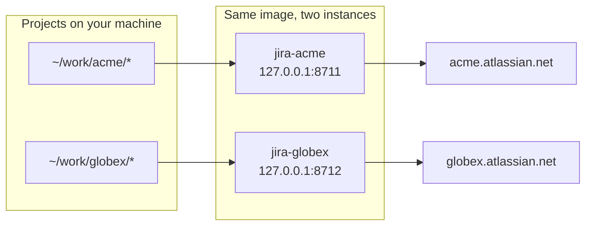
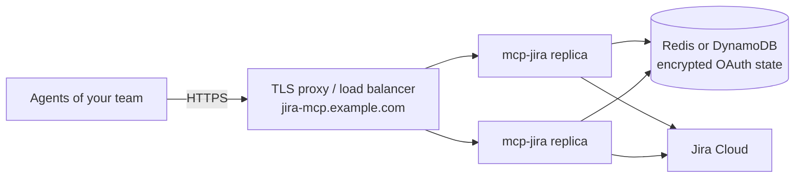

<div align="center">

# mcp-jira

**A lightweight Jira Cloud MCP server for your local agent harness.**

Your agent reads the task (including its screenshots and videos), does the work, and reports back on the ticket.
Each person signs in with their own Atlassian account. Nothing in Jira can be edited or deleted.

[](https://github.com/andriitk/mcp-jira/actions/workflows/ci.yml)


[](LICENSE)

[Quick start](#quick-start) · [Tools](#tools) · [Several Jira sites](#several-jira-sites) · [Configuration](#configuration) · [Deploying](#beyond-localhost) · [Security](#security)

</div>

---

> **Built for a local harness.** mcp-jira runs as a small container next to your agent and is reached on
> `localhost`. The same image also runs as a standalone service on any cloud. Going from laptop to team service
> takes infrastructure changes only: a TLS endpoint and shared, encrypted state in Redis or DynamoDB, both built in.
> See [Beyond localhost](#beyond-localhost).

## Why

Agents are good at coding against a ticket, but only if they can actually *read* it: the description, acceptance
criteria, comment thread, and the screenshot or screen recording that shows the bug. mcp-jira gives them that with
a deliberately small surface:

- 🔐 **Per-user OAuth 2.0.** You approve access in the browser through your normal Atlassian login (SSO works). There
  are no API tokens in config files, and every call carries your own Jira permissions.
- 🖼️ **Sees attachments.** Images arrive inline. Videos and GIFs arrive as timestamped frames. Logs and other text
  files arrive as text.
- 🛡️ **Safe by design.** The agent can read, comment and create issues. It cannot edit, transition or delete anything.
- 🏢 **One instance per Jira site.** If you work across organisations, each site gets its own container and its own
  sign-in, and the agent knows which is which.
- 🪶 **Lightweight.** Six tools and about 1.4k tokens of tool definitions. No database is needed for local use.

## How it works



To your MCP client, mcp-jira is an OAuth-protected server. To Atlassian, it is an OAuth app. Your Atlassian tokens
never leave the server: they are stored encrypted and refreshed automatically, and the client only holds a token for
mcp-jira itself. The full flow is described in [docs/authentication.md](docs/authentication.md).

## Tools

| Tool | Access | Description |
|---|:---:|---|
| `get_issue` | read | The issue as Markdown: fields, description, filled-in custom fields (acceptance criteria, sprint, …), subtasks, links, attachment list and comments |
| `get_attachment` | read | Shows an attachment: images inline, videos and animated GIFs as timestamped frames, text files as text |
| `search_issues` | read | JQL search, one compact line per issue |
| `whoami` | read | Which Jira site and account this instance acts as |
| `add_comment` | write | Posts a comment written in Markdown (headings, lists, code, links) and returns a direct link to it |
| `create_issue` | write | Creates an issue: Markdown description, type, labels, priority, parent, optional self-assignment |

A typical request:

> *Read ABC-123, implement it, open a pull request, and leave the PR link as a comment on the ticket.*

## Quick start

**Prerequisites:** Docker, [`just`](https://github.com/casey/just), an MCP client with OAuth support (for example,
[Claude Code](https://code.claude.com)).

### 1. Create an Atlassian OAuth app

Open the [Atlassian developer console](https://developer.atlassian.com/console/myapps/), signed in with the account
you use for the Jira site.

1. **Create → OAuth 2.0 integration**, access type **Resource-level**.
2. **Permissions → Jira API → Add → Configure → Classic scopes**: `read:jira-work`, `write:jira-work`, `read:jira-user`.
3. **Authorization → OAuth 2.0 (3LO)**: callback URL `http://localhost:8711/auth/callback` (use the port you will publish).
4. **Settings**: copy the client ID and the secret.

### 2. Configure and start an instance

Instance configuration lives outside the repository, in `~/.config/mcp-jira/<name>.env` (mode `0600`):

```bash
git clone https://github.com/andriitk/mcp-jira.git && cd mcp-jira

just init acme 8711                   # creates ~/.config/mcp-jira/acme.env
$EDITOR ~/.config/mcp-jira/acme.env   # JIRA_SITE_URL, ATLASSIAN_CLIENT_ID, ATLASSIAN_CLIENT_SECRET
just up acme                          # builds the image and starts it on 127.0.0.1:8711
```

### 3. Connect your agent and sign in

```bash
claude mcp add --transport http jira-acme http://localhost:8711/mcp
```

In Claude Code, run `/mcp`, select `jira-acme`, and choose **Authenticate**. In the browser, approve the
connection, log in to Atlassian, and accept access for your site. Your session survives restarts.

Other MCP clients work the same way: point them at `http://localhost:<port>/mcp`, and they discover the sign-in
flow automatically. See [docs/clients.md](docs/clients.md).

## Several Jira sites

Run one instance per site. They share one image and differ only in their env files.



```bash
just init globex 8712 && $EDITOR ~/.config/mcp-jira/globex.env && just up globex
```

Each instance announces which organisation it belongs to (`JIRA_INSTANCE_NAME`, optional `JIRA_AGENT_HINT`) and
rejects tokens issued for any other site. To show an instance only in the projects where it belongs, register it
per project rather than globally; [docs/clients.md](docs/clients.md#one-site-per-project) shows how.

| Command | What it does |
|---|---|
| `just ps` | List running instances |
| `just logs <name>` | Follow an instance's log |
| `just down <name>` | Stop an instance; its sign-ins are kept |
| `just up <name>` | Start or update an instance |

## Configuration

All settings are environment variables. See [`.env.example`](.env.example).

| Variable | Default | Purpose |
|---|---|---|
| **Instance** | | |
| `JIRA_SITE_URL` | required | `https://<site>.atlassian.net`; tokens for other sites are rejected |
| `ATLASSIAN_CLIENT_ID` / `ATLASSIAN_CLIENT_SECRET` | required | The OAuth 2.0 (3LO) app |
| `JIRA_INSTANCE_NAME` | `Jira` | Label shown to the agent |
| `JIRA_AGENT_HINT` | | Extra guidance for the agent, e.g. when to use this instance |
| **Network & OAuth** | | |
| `BASE_URL` | `http://localhost:8000` | Public URL of the server; OAuth redirects are built from it |
| `BASE_API_PATH` | | Mount prefix behind a shared ingress, e.g. `/api/jira` |
| `ALLOWED_CLIENT_REDIRECT_URIS` | any | Comma-separated callback patterns for MCP clients |
| `OAUTH_CONSENT` | `always` | `always`: show the consent screen for every client authorization; `remember`: skip it for approved clients |
| `OAUTH_ENABLE_CIMD` | `false` | Accept URL-based client IDs (Client ID Metadata Documents) in addition to dynamic registration |
| `JWT_SIGNING_KEY` | derived | Signs the tokens issued to MCP clients; set explicitly in production |
| **State** | | |
| `OAUTH_STORAGE` | `file` | `file`, `redis`, or `dynamodb` |
| `OAUTH_STORAGE_ENCRYPTION_KEY` | | Fernet key; required for `redis` and `dynamodb` |
| `OAUTH_REDIS_URL` | | `redis://` or `rediss://` |
| `OAUTH_DYNAMODB_TABLE` / `_REGION` / `_ENDPOINT_URL` | `mcp-jira-oauth` | DynamoDB table; created on first use if missing |
| **Local conveniences** | | |
| `DOWNLOADS_DIR` / `HOST_DOWNLOADS_DIR` | | Also save attachments where a local agent can open them (`just up` sets these) |
| `ENVIRONMENT` / `LOG_LEVEL` | `local` / `info` | Any `ENVIRONMENT` other than `local` switches to JSON logs |

## Beyond localhost

The container is production-shaped: it runs as non-root, works with a read-only root filesystem, exposes a health
check at `/health`, and is stateless when backed by shared storage.



| Target | Status | What changes |
|---|---|---|
| Laptop / local harness | ✅ Ready | `just up` |
| Single VM (EC2, Compute Engine, …) | ✅ Ready | TLS proxy in front, `BASE_URL`, a volume for `/data` |
| Containers (ECS/Fargate, Kubernetes, Cloud Run) | ✅ Ready | Plus `OAUTH_STORAGE=redis` or `dynamodb` for several replicas |
| Serverless (AWS Lambda) | 🧩 Adapter needed | Run the image with the AWS Lambda Web Adapter and `OAUTH_STORAGE=dynamodb` |

The step-by-step guide, including the Atlassian app settings for a shared deployment, is in
[docs/deployment.md](docs/deployment.md).

## Security

- **Your identity, your permissions.** Every Jira call runs as the signed-in user; there is no shared service account.
- **Site-pinned tokens.** A token is accepted only if Atlassian confirms it grants the Jira scopes on the configured site.
- **No destructive tools.** Writes are limited to adding comments and creating issues, and both are annotated as
  writes, so clients can ask for confirmation.
- **Encrypted state.** OAuth state is encrypted at rest, in local files or in Redis/DynamoDB.
- **Hardened by default.** Every request has its Host and Origin validated (DNS-rebinding protection). `just up`
  publishes on `127.0.0.1` only, and the container drops all Linux capabilities.
- **Nothing private in git.** Instance configs and downloaded attachments live outside the repository.

Please report vulnerabilities privately; see [SECURITY.md](SECURITY.md).

## Development

```bash
just tests     # lint, format check and tests in Docker (Python 3.15)
just lint      # apply lint fixes and formatting
just lock      # refresh uv.lock
```

The tool schemas are snapshot-tested, because they are the contract MCP clients rely on. Contributions are
welcome; see [CONTRIBUTING.md](CONTRIBUTING.md).

## License

[MIT](LICENSE)
