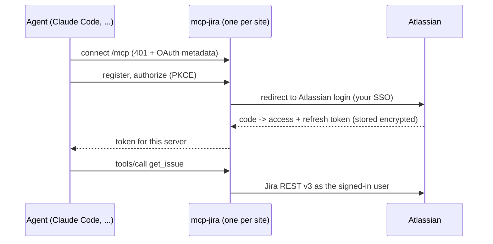

# mcp-jira

A lightweight Jira Cloud MCP server for agent harnesses. It lets an agent **read a task properly** (fields,
description, comments, and the screenshots, GIFs and videos attached to it), **report back** with a comment,
and **create issues** when asked. It cannot edit, transition or delete anything.

- **Per-user OAuth 2.0.** Each person signs in with their own Atlassian account in the browser; the agent
  sees exactly what that person may see. No API tokens in config files.
- **One container per Jira site.** Work with several organisations side by side: run one instance per site,
  each under its own name, and the agent picks the right one.
- **Runs anywhere.** The same image runs on a laptop behind `localhost` or behind a TLS proxy for a team,
  with shared OAuth state in Redis for several replicas.
- **Small surface.** Six tools, about 1.4k tokens of definitions.

## Tools

| Tool | Access | What it does |
|---|---|---|
| `get_issue` | read | Issue as Markdown: fields, description, non-empty custom fields (acceptance criteria, sprint, ...), subtasks, links, attachment list, comments |
| `get_attachment` | read | Images inline; videos and animated GIFs as timestamped frames; text files as text. Locally, also saved to disk for other tools (PDFs, archives) |
| `search_issues` | read | JQL search, one line per issue |
| `whoami` | read | Which site and account this instance acts as |
| `add_comment` | write | Comment from Markdown (lists, code, links), returns a direct link |
| `create_issue` | write | New issue from Markdown; type, labels, priority, parent, assign to self |

A typical request: *"Read ABC-123, implement it, open a pull request and leave the PR link as a comment on the task."*

## How it works



The server is an OAuth authorization server towards MCP clients and an OAuth client towards Atlassian
(built on FastMCP's `OAuthProxy`). Atlassian's one-hour access tokens and rotating refresh tokens are
refreshed transparently; the MCP client never sees them.

## Quick start (local, Docker)

Requirements: Docker, [`just`](https://github.com/casey/just), and an MCP client such as Claude Code.

**1. Create an Atlassian OAuth app** at <https://developer.atlassian.com/console/myapps/>, signed in with the
account you use for that Jira site:

1. *Create* -> *OAuth 2.0 integration*.
2. *Permissions* -> *Jira API* -> *Add*, then *Configure* -> classic scopes `read:jira-work`, `write:jira-work`,
   `read:jira-user`.
3. *Authorization* -> *OAuth 2.0 (3LO)* -> callback URL `http://localhost:8711/auth/callback`
   (the port you will publish this instance on).
4. *Settings* -> copy the client ID and secret.

**2. Create the instance config.** It lives outside the repository, in `~/.config/mcp-jira/<name>.env`:

```bash
just init acme 8711
$EDITOR ~/.config/mcp-jira/acme.env   # JIRA_SITE_URL, ATLASSIAN_CLIENT_ID, ATLASSIAN_CLIENT_SECRET
```

**3. Start it:**

```bash
just up acme        # builds the image, starts mcp-jira-acme on 127.0.0.1:8711, waits until healthy
```

**4. Connect your agent and sign in.** For Claude Code:

```bash
claude mcp add --transport http --scope user jira-acme http://localhost:8711/mcp
```

Then run `/mcp` in Claude Code, choose `jira-acme`, *Authenticate*: the browser opens, you approve the
connection, log in to Atlassian (SSO works as usual) and accept. Done; the session survives restarts.

### Several Jira sites

Repeat steps 1-4 with another name and port, e.g. `just init globex 8712`, its own Atlassian app with callback
`http://localhost:8712/auth/callback`, and `claude mcp add ... jira-globex http://localhost:8712/mcp`. Sign in to
each with the right account. Each instance tells the agent which organisation it belongs to
(`JIRA_INSTANCE_NAME`, optional `JIRA_AGENT_HINT` such as "repositories under ~/work/globex").

```bash
just ps             # running instances
just logs acme      # follow one
just down acme      # stop (OAuth state is kept in its volume)
```

## Configuration

| Variable | Default | Purpose |
|---|---|---|
| `JIRA_SITE_URL` | required | `https://<site>.atlassian.net`; tokens for other sites are rejected |
| `ATLASSIAN_CLIENT_ID`, `ATLASSIAN_CLIENT_SECRET` | required | The OAuth 2.0 (3LO) app |
| `JIRA_INSTANCE_NAME` | `Jira` | Label the agent sees |
| `JIRA_AGENT_HINT` | | Extra instructions: when to use this instance |
| `BASE_URL` | `http://localhost:8000` | Public URL of the server; OAuth redirects are built from it |
| `BASE_API_PATH` | | Mount prefix behind a shared ingress, e.g. `/api/jira` |
| `ALLOWED_CLIENT_REDIRECT_URIS` | any | Comma-separated MCP client callback patterns, e.g. `http://localhost:*,https://claude.ai/*` |
| `OAUTH_CONSENT` | `always` | `always` shows the consent screen on every client authorization; `remember` skips it for approved clients |
| `OAUTH_ENABLE_CIMD` | `false` | Accept URL client IDs (Client ID Metadata Documents). Off: clients use dynamic registration, which does not depend on fetching the client's metadata from the internet |
| `JWT_SIGNING_KEY` | derived | Signs tokens issued to MCP clients; set explicitly in production |
| `OAUTH_REDIS_URL` | | Shared OAuth state for several replicas (encrypted) |
| `OAUTH_STORAGE_ENCRYPTION_KEY` | | Fernet key, required with `OAUTH_REDIS_URL` |
| `DOWNLOADS_DIR`, `HOST_DOWNLOADS_DIR` | | Save attachments where a local agent can open them (`just up` sets these) |
| `ENVIRONMENT` | `local` | Anything else switches to JSON logs |
| `LOG_LEVEL` | `info` | |

See [`.env.example`](.env.example).

## Deploying for a team

The runtime image is self-contained (non-root, read-only filesystem friendly, health check at `/health`).

1. Run it behind TLS, e.g. `https://jira-mcp.example.com`, and set `BASE_URL` to that URL. If the proxy sets
   `X-Forwarded-*`, set uvicorn's `FORWARDED_ALLOW_IPS` to the proxy address.
2. Add `https://jira-mcp.example.com/auth/callback` to the Atlassian app, and enable *Distribution* there so
   accounts other than the app owner can authorize it.
3. Set `JWT_SIGNING_KEY` and restrict `ALLOWED_CLIENT_REDIRECT_URIS` to the clients you support.
4. One replica: mount a volume at `/data`. Several replicas: set `OAUTH_REDIS_URL` and
   `OAUTH_STORAGE_ENCRYPTION_KEY` (the image includes the Redis extra).
5. Leave `DOWNLOADS_DIR` unset: remote agents receive previews inline and open originals in Jira.

## Security model

- Every call runs as the signed-in user with Atlassian's own permission checks; there is no shared account.
- A token is accepted only if Atlassian confirms it grants the Jira scopes on the configured site.
- No update, transition or delete tools. Writes are limited to adding comments and creating issues, and both
  are marked as writes so clients can ask for confirmation.
- Host/Origin validation on every request (DNS-rebinding protection); `just up` publishes on `127.0.0.1` only.
- OAuth state is encrypted at rest (local files or Redis). Instance configs and downloads live outside the
  repository.

Report vulnerabilities privately; see [SECURITY.md](SECURITY.md).

## Development

```bash
just tests     # ruff check, ruff format --check, pytest with coverage (in Docker, Python 3.15)
just lint      # apply ruff fixes and formatting
just lock      # refresh uv.lock
```

```
src/mcp_jira/
├── app.py            FastMCP server + ASGI app factories, /health
├── asgi.py           ASGI entry point (uvicorn --factory)
├── containers.py     dependency-injector container, auth wiring, bootstrap()
├── settings.py       pydantic-settings, grouped by concern
├── auth/atlassian.py Atlassian OAuthProxy + token verifier
├── misc/             DI bridge for FastMCP Depends(), lifespan, logging
└── tools/
    ├── __init__.py   the registry of exposed tools
    └── jira/         client, tools, schemas, ADF <-> Markdown, attachment previews, rendering
```

`tests/test_mcp.py` snapshots every tool schema: it is the contract MCP clients see. After an intentional
change, run `pytest tests/test_mcp.py --inline-snapshot=fix` and read the diff.

## License

[MIT](LICENSE)
