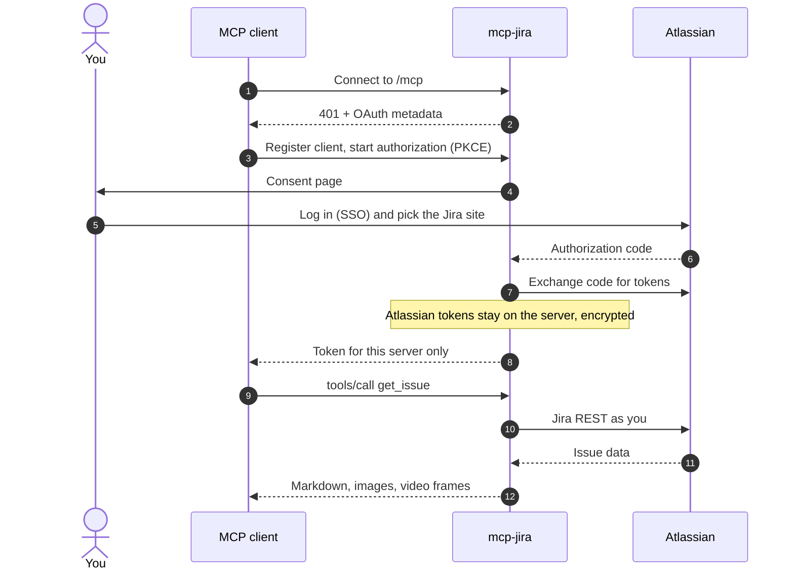

# Authentication

mcp-jira implements the [MCP authorization](https://modelcontextprotocol.io/specification/latest/basic/authorization)
flow towards your MCP client and Atlassian OAuth 2.0 (3LO) towards Jira. There are two OAuth relationships:

| | Your MCP client ↔ mcp-jira | mcp-jira ↔ Atlassian |
|---|---|---|
| mcp-jira acts as | Authorization server | OAuth client (your Atlassian app) |
| Token | Short-lived token for this server only | Atlassian access + refresh token |
| Where it lives | In your MCP client | On the server, encrypted |

Your MCP client never sees an Atlassian token. If a client token leaks, it is only good against this one server, and
mcp-jira still checks it against Atlassian on every use.

## Sign-in flow



1. The client calls `/mcp` without a token and receives `401` with a link to the server's OAuth metadata.
2. The client registers itself through dynamic client registration and starts an authorization request with PKCE.
3. mcp-jira shows a consent page, so you can see which client is asking for access before anything else happens.
4. You log in to Atlassian with your usual method (SSO, MFA) and choose the Jira site.
5. mcp-jira exchanges the code for Atlassian tokens and stores them encrypted. It then issues its own token to the
   client.

## Every request

- **Site pinning.** mcp-jira accepts an Atlassian token only if the token grants the Jira scopes on `JIRA_SITE_URL`.
  A token for a different site is rejected even if it is otherwise valid. Verification results are cached for a few
  minutes.
- **Refresh.** Atlassian access tokens last one hour. mcp-jira refreshes them shortly before they expire and stores
  the rotated refresh token. You stay signed in as long as the integration is used: Atlassian expires refresh tokens
  after about 90 days of inactivity.
- **Sign out.** Use your client's *Clear authentication* (in Claude Code: `/mcp`), or revoke the app under
  *Atlassian account → Security → Connected apps*.

## Scopes

| Scope | Why |
|---|---|
| `read:jira-work` | Read issues, comments, attachments; search |
| `write:jira-work` | Add comments, create issues |
| `read:jira-user` | Identify the signed-in user (`whoami`, assign to self) |
| `offline_access` | Refresh tokens (requested automatically) |

Use a **Resource-level** app. It limits each authorization to the one site the user selects.

## Where state lives

| `OAUTH_STORAGE` | Use it for | Encryption |
|---|---|---|
| `file` (default) | One container with a persistent `/data` volume | Encrypted files |
| `redis` | Several replicas | Every value encrypted with `OAUTH_STORAGE_ENCRYPTION_KEY` (Fernet) before it is written |
| `dynamodb` | Several replicas, serverless | Same as Redis |

Generate an encryption key:

```bash
python -c 'from cryptography.fernet import Fernet; print(Fernet.generate_key().decode())'
```

Keep `OAUTH_STORAGE_ENCRYPTION_KEY` and `JWT_SIGNING_KEY` stable. Rotating either one signs everyone out.

## Client registration: DCR and CIMD

MCP clients identify themselves in one of two ways:

- **Dynamic client registration (DCR)**: the client registers with the server. This is the default and works everywhere.
- **Client ID Metadata Documents (CIMD)**: the client presents a URL, and the server downloads the client's metadata
  from it. Enable with `OAUTH_ENABLE_CIMD=true`.

CIMD is off by default because it makes sign-in depend on the server being able to fetch a third-party URL. Bot
protection in front of such URLs can reject server-side requests.

## Troubleshooting

| Symptom | Cause and fix |
|---|---|
| Browser shows **Client Not Registered** with a URL client ID | The client cached a registration from an earlier configuration. Clear the client's saved authentication for this server and sign in again. If your client offers no such option, re-add the server; changing its URL or headers gives it a fresh registration |
| **Login failed / site not granted** | You picked a different site on the Atlassian consent screen, or `JIRA_SITE_URL` does not match. Sign in again and pick the configured site |
| `401` on every call after a long break | The refresh token expired. Sign in again |
| Atlassian asks for **admin approval** | Your organisation restricts user-installed OAuth apps; an admin has to allow the app |
