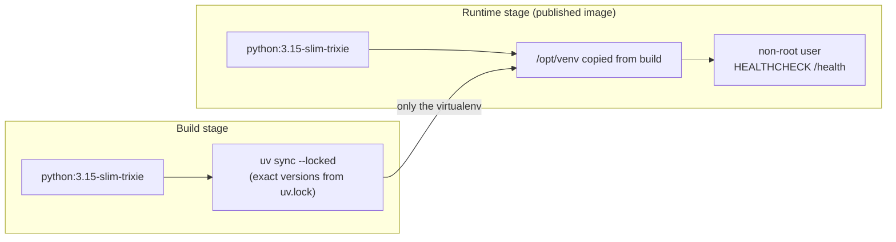

# Deployment

mcp-jira is built for a local agent harness, and the same container runs as a shared service. This page covers the
image, local operation and the changes needed for each hosting model.

## The image



- **Reproducible.** Dependencies are pinned in `uv.lock` and installed with `--locked`.
- **Small attack surface.** The runtime stage has no compilers, package managers or sources; it runs as an
  unprivileged user.
- **Read-only friendly.** The only writable paths are `/data` (OAuth state when `OAUTH_STORAGE=file`) and `/tmp`.
- **Listens on** `0.0.0.0:8000`. Override with `HOST` and `PORT`.

Build it:

```bash
docker build --target runtime -t mcp-jira .
```

## Local (Docker Compose)

`just up <name>` wraps Docker Compose. It publishes the instance on `127.0.0.1:<port>`, gives it its own volume for
OAuth state, and restarts it with Docker. Configuration is read from `~/.config/mcp-jira/<name>.env`. Each instance
is a separate Compose project, so instances never share state.

## Shared deployment: what changes

| Change | Why |
|---|---|
| Serve over HTTPS and set `BASE_URL=https://jira-mcp.example.com` | OAuth redirects and token audiences are derived from it |
| Add `https://jira-mcp.example.com/auth/callback` to the Atlassian app | Atlassian only redirects to registered callbacks |
| Enable **Distribution** in the Atlassian app | Otherwise only the app owner can authorize it |
| Set `JWT_SIGNING_KEY` | Tokens stay valid across restarts and replicas |
| Set `ALLOWED_CLIENT_REDIRECT_URIS` | Limits which client callbacks may receive codes |
| `OAUTH_STORAGE=redis` or `dynamodb`, plus `OAUTH_STORAGE_ENCRYPTION_KEY` | Shared state for more than one replica |
| Leave `DOWNLOADS_DIR` unset | Remote agents do not share the server's disk; previews are returned inline |

Keep secrets (client secret, signing and encryption keys) in your platform's secret store and inject them as
environment variables.

## Single VM (EC2, Compute Engine, a VPS)

The simplest shared setup: one container, a volume, and a TLS proxy.

```bash
docker run -d --name mcp-jira --restart unless-stopped \
  -p 127.0.0.1:8000:8000 -v mcp-jira-data:/data --read-only --tmpfs /tmp \
  --env-file /etc/mcp-jira.env \
  mcp-jira
```

Example TLS proxy with [Caddy](https://caddyserver.com), which obtains certificates automatically:

```caddyfile
jira-mcp.example.com {
    reverse_proxy 127.0.0.1:8000
}
```

When the proxy sets `X-Forwarded-*` headers, set `FORWARDED_ALLOW_IPS` to the proxy's address.

## Containers (ECS/Fargate, Kubernetes, Cloud Run)

Run as many replicas as you like behind a load balancer, with shared state in Redis or DynamoDB. MCP requests are
handled statelessly, so no sticky sessions are needed. Use `/health` for liveness and readiness probes.

**DynamoDB.** The table (default `mcp-jira-oauth`) is created on first use. To create it yourself instead: partition
key `collection` (String), sort key `key` (String), on-demand billing. Minimal IAM policy for the task role:

```json
{
  "Version": "2012-10-17",
  "Statement": [{
    "Effect": "Allow",
    "Action": [
      "dynamodb:GetItem", "dynamodb:PutItem", "dynamodb:DeleteItem",
      "dynamodb:DescribeTable", "dynamodb:DescribeTimeToLive", "dynamodb:UpdateTimeToLive"
    ],
    "Resource": "arn:aws:dynamodb:<region>:<account>:table/mcp-jira-oauth"
  }]
}
```

Add `dynamodb:CreateTable` only if you want the table created automatically.

**Redis.** Any Redis 6+ works (ElastiCache, Memorystore, a sidecar). Use `rediss://` when TLS is available.

## Serverless (AWS Lambda)

The image can run on Lambda through the [AWS Lambda Web Adapter](https://github.com/awslabs/aws-lambda-web-adapter),
which forwards Lambda invocations to the HTTP server inside the container. This path is documented but not yet part
of the tested matrix.

```dockerfile
FROM mcp-jira
# Pin the adapter to a current release.
COPY --from=public.ecr.aws/awsguru/aws-lambda-adapter:<version> /lambda-adapter /opt/extensions/lambda-adapter
ENV AWS_LWA_PORT=8000 \
    AWS_LWA_READINESS_CHECK_PATH=/health \
    AWS_LWA_INVOKE_MODE=response_stream
```

- Expose it through a Function URL in `RESPONSE_STREAM` mode, or through API Gateway. Point `BASE_URL` at that URL
  or your custom domain.
- Set `OAUTH_STORAGE=dynamodb`. Lambda has no persistent disk.
- Allow a timeout of at least 60 s and 1 GB of memory. Video previews are CPU-bound.

## Checklist

- [ ] `/health` returns `200` through the public URL
- [ ] `POST /mcp` without a token returns `401` with a `WWW-Authenticate` header
- [ ] `/.well-known/oauth-authorization-server` lists your public URL
- [ ] One full sign-in from a client, then `whoami`
- [ ] Restart or redeploy, then call `whoami` again without signing in
